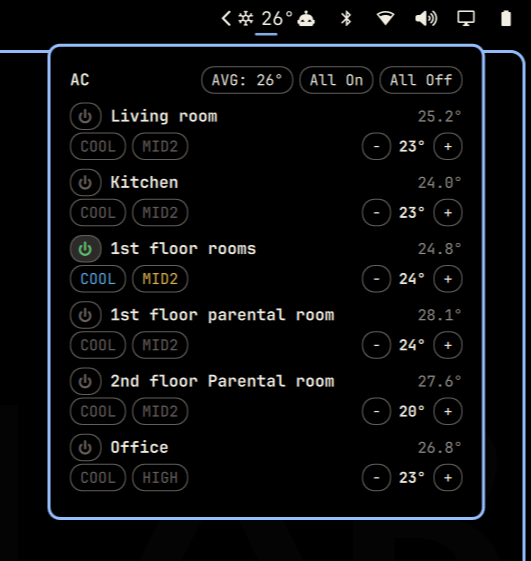

# mhvac.ac — Omarchy AC control plugin

Bar widget for the Omarchy shell (Quickshell) that controls a Mitsubishi
M-NET HVAC system: per-zone status, on/off, mode, temperature, and fan
speed, from a popup anchored to a bar icon.

If the gateway can't be reached (or the status call fails for any reason),
the bar icon switches to the theme's urgent/red color and drops the
temperature reading rather than showing a stale value.



## Requirements

- A Mitsubishi M-NET HVAC system reachable over the network through an
  HTTP/XML gateway (`servlet/MIMEReceiveServlet`) — this is a specific
  integration, not a generic "any AC" plugin. If your gateway doesn't
  speak this protocol, this plugin won't talk to it.
- `python3` on `PATH` with pip available (`python3 -m pip --version` works).
  The only third-party dependency, `requests`, is installed automatically
  into the user site on first run if it is missing — if an interpreter
  upgrade swaps `python3` and drops installed packages, the plugin
  self-heals on the next poll instead of silently failing.
- Network access from the machine running Omarchy to the gateway.

No elevated privileges are needed — everything runs as your normal user.

The M-NET HTTP/XML gateway protocol provides no authentication or
encryption. This plugin assumes the gateway is reachable only over a trusted
LAN; do not expose it directly to untrusted networks or the public internet.

## Install

```bash
omarchy plugin add https://github.com/aallamaa/hvac.git --enable
```

Then place it on the bar (if `--enable` didn't already):

```bash
omarchy bar move mhvac.ac --section right
```

The widget works without a terminal shortcut. To use the shorter `ac ...`
commands shown below, install an optional symlink to the deployed CLI:

```bash
mkdir -p ~/.local/bin
ln -s ~/.config/omarchy/plugins/mhvac.ac/ac_cli.py ~/.local/bin/ac
```

If that path already exists, inspect or remove it before creating the link;
the command intentionally does not overwrite an existing file.

## Usage

Click the snowflake icon in the bar to open the popup. Each zone shows:

- a power button (on/off)
- the current room temperature
- a mode button (cycles through that zone's supported modes)
- a fan-speed button (cycles through that zone's supported speeds)
- an air-direction button when the indoor unit reports vane control support
- a −/+ temperature stepper

An active filter-cleaning reminder shows the `󰵃` filter icon in the urgent
color; hover it to see `Filter ON`. Active faults add `[FAULT]` in the urgent
color; use `ac alarms` for the controller's detailed M-NET address, numeric
alarm code, model, and detection time.

"All On"/"All Off" at the top act on every configured zone. The "AVG: N°"
button next to them cycles the bar icon's own temperature display through
`avg`/`min`/`max`/`off` (see Configure).

The bar icon itself shows an aggregate temperature reading whenever sensor
data is available (regardless of whether a zone is on), and turns the theme's
urgent/red color if the gateway can't be reached.

## Configure

Gateway host/port, zone names, and per-zone capabilities live in
`~/.config/ac-plugin/config.json`, not in the code:

```json
{
  "host": "192.168.1.2",
  "port": 80,
  "icon_temp": "avg",
  "zones": {
    "1": { "name": "Living room", "modes": ["COOL", "DRY", "FAN"], "fan_speeds": ["AUTO", "MID1", "MID2", "HIGH"], "air_directions": [] },
    "6": { "name": "Office", "modes": ["COOL", "HEAT", "DRY", "FAN"], "fan_speeds": ["LOW", "MID1", "MID2", "HIGH"], "air_directions": ["HORIZONTAL", "MID1", "MID2", "VERTICAL"] }
  }
}
```

`icon_temp` controls what number the bar icon shows next to the snowflake
across available zone temperature readings:
`avg` (default), `min`, `max`, or `off`. It's also editable straight from
the popup — the "AVG: N°" button in the header cycles through the four
values.

`modes`/`fan_speeds` are what the popup's mode/fan cycle buttons step
through for that zone — see "Per-zone capability discovery" below for
where they come from. A zone can also be given as a plain name string
(`"1": "Living room"`); it's upgraded on load to the full shape above,
filled in with not-yet-discovered defaults.

If this file (or its `zones` key) is missing, the popup shows a **Discover
zones** button instead of silently creating configuration. Set the gateway
address first if it is not the default, then click that button (or run
`ac zones-init`) to read the configured group inventory and names. On firmware
without the inventory API discovery falls back to probing the 50 possible
group slots. It never assumes zones 1–6. An explicit `"zones": {}` is
authoritative and means “query and control no groups.” Invalid or unreadable
configuration fails closed instead of restoring built-in control targets.
The initial gateway default is `192.168.1.2`; use `set-host` or `AC_HOST` /
`AC_PORT` to point discovery elsewhere. `AC_CONFIG_FILE` overrides the path.

### Finding your zones

```bash
ac discover            # read the group inventory (with probe fallback)
ac zones-init          # same, then add groups and gateway-configured names
ac rename 3 "Kids room"
ac set-host 192.168.1.50
```

`set-host` changes only the gateway address; it deliberately retains existing
zone names and discovered capabilities so an IP-address change does not erase
your setup. If the new address points to different hardware, reconcile the
saved zones before using bulk controls: run `zones-init` to add newly discovered
groups, then remove stale groups from `config.json` (and run
`discover-features` to refresh capabilities).

Before replacing an existing configuration, the CLI keeps one recovery copy
at `~/.config/ac-plugin/config.json.backup`. To restore it, copy it back over
`config.json` while no AC command is running, then reopen the popup:

```bash
cp ~/.config/ac-plugin/config.json.backup ~/.config/ac-plugin/config.json
```

### Per-zone capability discovery

Different indoor unit models on the same M-NET system can support different
modes and fan speeds. `discover-features` reads the gateway's capability flags
(`IcKind`, mode switches, fan-stage count, and automatic-fan support) and saves
the resulting per-zone choices. It is entirely read-only and does not turn off
or change any HVAC unit.

```bash
ac discover-features        # every configured zone
ac discover-features 6      # just zone/group 6
```

`AUTOCOOL`/`AUTOHEAT` remain display-only statuses: Mitsubishi integration
documentation marks them as not applicable for setting, so the plugin never
writes them. Capability results also report air-direction, swing, filter-sign,
and error-sign availability in the CLI output.

## Update

```bash
omarchy plugin update mhvac.ac --yes
```

## Remove

```bash
omarchy plugin remove mhvac.ac --yes
```

That removes the plugin from the bar and deletes
`~/.config/omarchy/plugins/mhvac.ac/`. It leaves two things behind, which
you can delete yourself if you want a full cleanup:

```bash
rm -rf ~/.config/ac-plugin           # host/zone/capability config
rm -f ~/.local/bin/ac                # the `ac` CLI shortcut, if installed
```

## Development

Source of truth is this repo; `~/.config/omarchy/plugins/mhvac.ac/` holds
a deployed copy (Omarchy's plugin validator rejects symlinks inside a
plugin folder, so it can't just point back here). After editing files,
redeploy with:

```bash
cp mit.py ac_cli.py Panel.qml manifest.json ~/.config/omarchy/plugins/mhvac.ac/
```

QML edits hot-reload automatically once copied; if changes don't seem to
apply, `omarchy restart shell` forces a clean reload.

- `mit.py` — M-NET client (XML over HTTP to the gateway), used as a
  library.
- `ac_cli.py` — CLI wrapper around `mit.py`. The QML shells out to this
  for every read and write; it's also usable standalone from a terminal.
- `Panel.qml` — the bar icon + popup (Quickshell/QML).
- `manifest.json` — Omarchy plugin manifest (`id: mhvac.ac`).

### Running ac_cli.py commands directly

There's no `omarchy plugin <id> <command>` passthrough — `omarchy plugin`
only manages plugin lifecycle (list/enable/disable/validate). To run
`ac_cli.py` commands yourself, either call it directly:

```bash
python3 ~/.config/omarchy/plugins/mhvac.ac/ac_cli.py status
```

or use the optional `ac` shortcut described under Install. It lives at
`~/.local/bin/ac` (normally on `PATH`) and calls the deployed copy:

```bash
ac status
```

Every subcommand prints one JSON value to stdout and exits 0 on success;
on failure it prints `{"error": "..."}` to stderr and exits 1.

### Commands

| Command | Args | Description |
|---|---|---|
| `status` | | Status of every configured zone (drive, mode, set temp, fan speed, inlet temp). |
| `config` | | Print the resolved config (host, port, zones). |
| `alarms` | | List active detailed controller alarms. Read-only. |
| `on` | `<group>` | Turn a zone on. |
| `off` | `<group>` | Turn a zone off. |
| `set-temp` | `<group> <temp>` | Set target temperature (16–30). |
| `set-fan` | `<group> <speed>` | Set fan speed: `AUTO`, `LOW`, `MID1`, `MID2`, or `HIGH`. Not every zone accepts every value — see "Per-zone capability discovery". |
| `set-mode` | `<group> <mode>` | Set mode: `COOL`, `HEAT`, `DRY`, `FAN`, or `AUTO`. Not every zone accepts every value — see "Per-zone capability discovery". |
| `set-air` | `<group> <direction>` | Set a capability-discovered vane position such as `HORIZONTAL`, `MID1`, `MID2`, `VERTICAL`, or `SWING`. |
| `all-on` | | Attempt to turn on every configured zone and report each result. |
| `all-off` | | Attempt to turn off every configured zone and report each result. |
| `discover` | `[--max N]` | Read configured groups from the inventory API, falling back to probes when unsupported. Doesn't touch the config. |
| `zones-init` | `[--max N]` | Run discovery and add new groups using controller-configured names when available; existing names are kept. |
| `discover-features` | `[group]` | Read mode/fan capability flags for a zone (or every configured zone) and save them. Does not change HVAC state. |
| `rename` | `<group> <name>` | Set a zone's display name in the config. |
| `set-host` | `<host> [port]` | Set the gateway host/port in the config (default port 80). |
| `set-icon-temp` | `<mode>` | Set the bar icon's temperature display: `avg`, `min`, `max`, or `off`. |

### Examples

```bash
ac status
ac on 3
ac set-temp 3 22
ac set-fan 3 HIGH
ac set-mode 3 COOL
ac rename 3 "Kids room"
ac discover --max 10
ac zones-init
ac discover-features
ac discover-features 6
ac set-host 192.168.1.2
```

## License

GPL-3.0-or-later — see [LICENSE](LICENSE).

## Protocol references

Mitsubishi does not appear to publish a public specification for the
`MIMEReceiveServlet` XML wire format. The closest vendor documentation found
is Mitsubishi Electric's [G-50A operation manual](https://mitsubishitech.co.uk/Data/Controls/Centralised_Controllers/2008/G-50A/G50A_OM.pdf)
and its [IP integration instructions](https://librairie.mitsubishielectric.fr/pdf/download_full/2511),
which document 50 groups and identify Auto Cool/Auto Heat as non-settable
statuses. The HTTP/XML packet details and one-group-at-a-time discovery are
based on observed gateway behavior and independently reverse-engineered
clients, not an official public wire-protocol specification.
